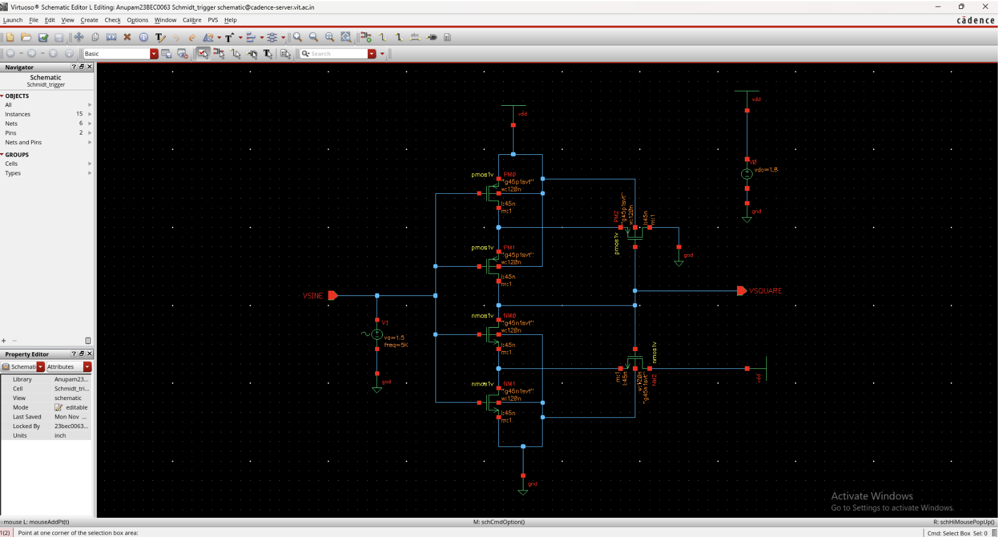
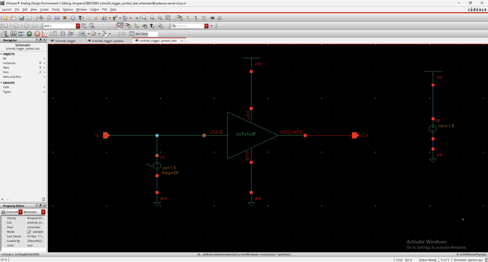
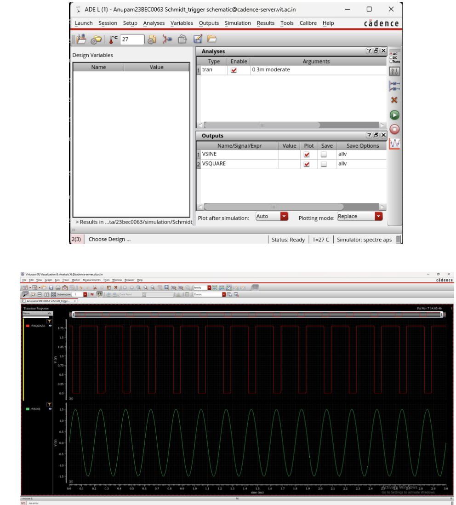
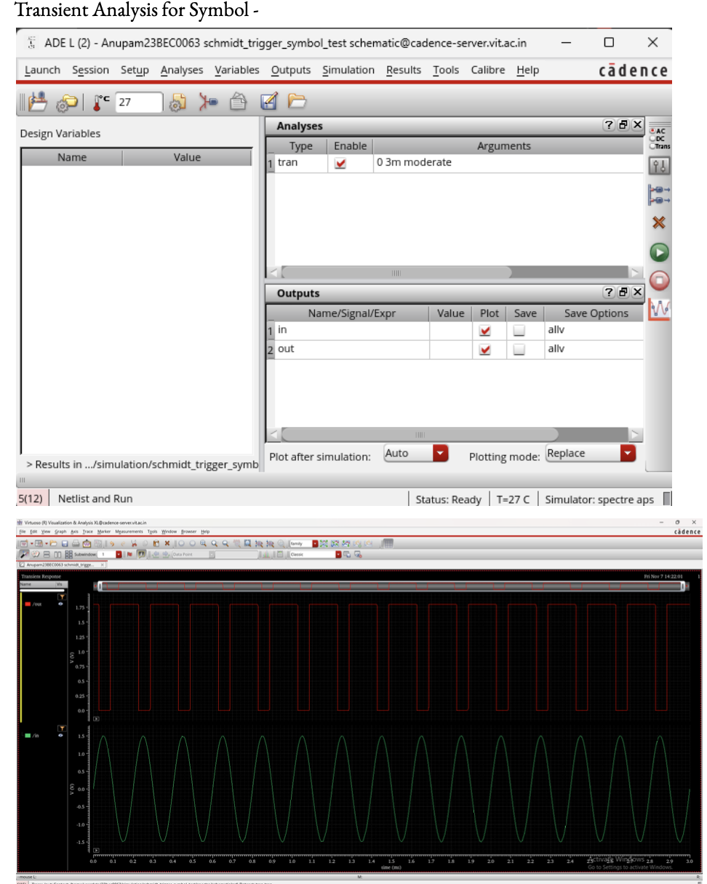

# CMOS-Schmitt-Trigger-Cadence
# CMOS Schmitt Trigger Design and Simulation

## Overview
This project focuses on the design and simulation of a CMOS Schmitt Trigger using Cadence Virtuoso. The work includes transistor-level schematic design, symbol creation, and transient analysis.

## Tools and Technology
- **EDA Tool:** Cadence Virtuoso
- **Technology Library:** gpdk090
- **Design Type:** Transistor-level CMOS circuit
- **Analysis:** Transient simulation

## Project Objectives
- Design the CMOS Schmitt Trigger schematic.
- Create a symbol view for circuit reuse.
- Perform transient analysis on the schematic and symbol.
- Study the hysteresis behavior of the Schmitt Trigger.

## CMOS Schematic
The transistor-level circuit was designed in Cadence Virtuoso.

## Symbol View
The symbol view allows the circuit to be instantiated in other designs.

## Transient Analysis — Schematic
Simulation results obtained from the schematic view.

## Transient Analysis — Symbol
Simulation results obtained using the symbol view.

## Project Report
The detailed project report is available here:

[`CMOS_Schmitt_Trigger_Project_Report.pdf`](docs/CMOS_Schmitt_Trigger_Project_Report.pdf)

## Team Project
This was a team project completed by **Damini Katakam, Anupam Hari, and Tia Rachel Fernandez**.

